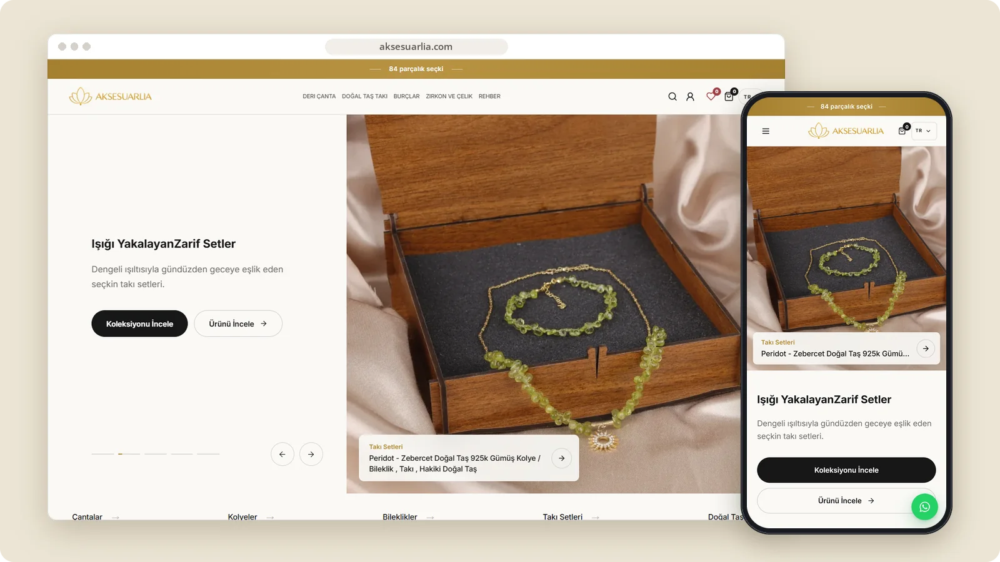

# Aksesuarlia

A boutique store for leather bags, natural-stone jewellery, zodiac designs and steel accessories.

**[Visit aksesuarlia.com ↗︎](https://aksesuarlia.com)** &nbsp;·&nbsp; [More work by Mert Ömeroğlu](https://github.com/mertomeroglu)

### Highlights

- Collection-led discovery for bags, jewellery and natural stones
- Search, account, wishlist and cart entry points
- Editorial care and material guides
- Responsive Turkish storefront

### Built with

Shopify · Liquid

### Screens

---

Presentation-only repository. Images are real, unmodified product screens in a simple frame; application source and private configuration are not published here. Brands and visual content belong to their respective owners — see [LICENSE](LICENSE).
