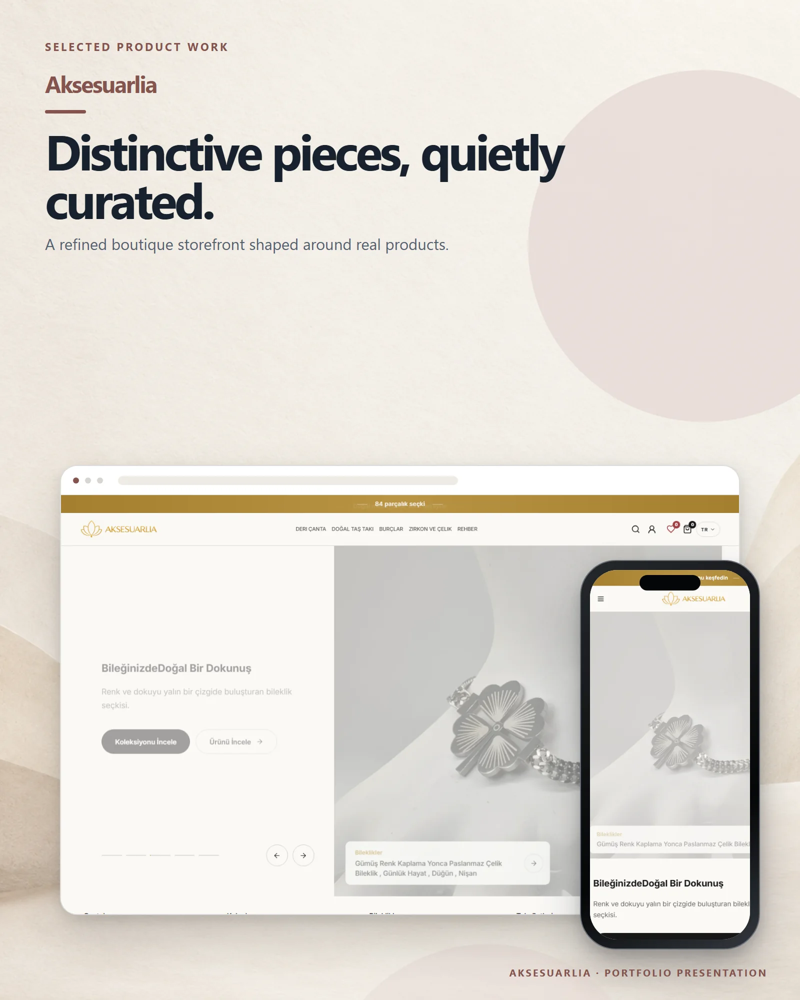

# Aksesuarlia

A boutique store for leather bags, natural-stone jewellery, zodiac designs and steel accessories.

**Live:** [aksesuarlia.com](https://aksesuarlia.com) &nbsp;·&nbsp; **More work:** [github.com/mertomeroglu](https://github.com/mertomeroglu)

### Highlights

- Collection-led discovery for bags, jewellery and natural stones
- Search, account, wishlist and cart entry points
- Editorial care and material guides
- Responsive Turkish storefront

### Built with

Shopify · Liquid

---

Presentation-only repository: this README and two presentation images built from real product screens. Application source and private configuration are not published here. Visual content and brand assets remain the property of their respective owners — see [LICENSE](LICENSE).
