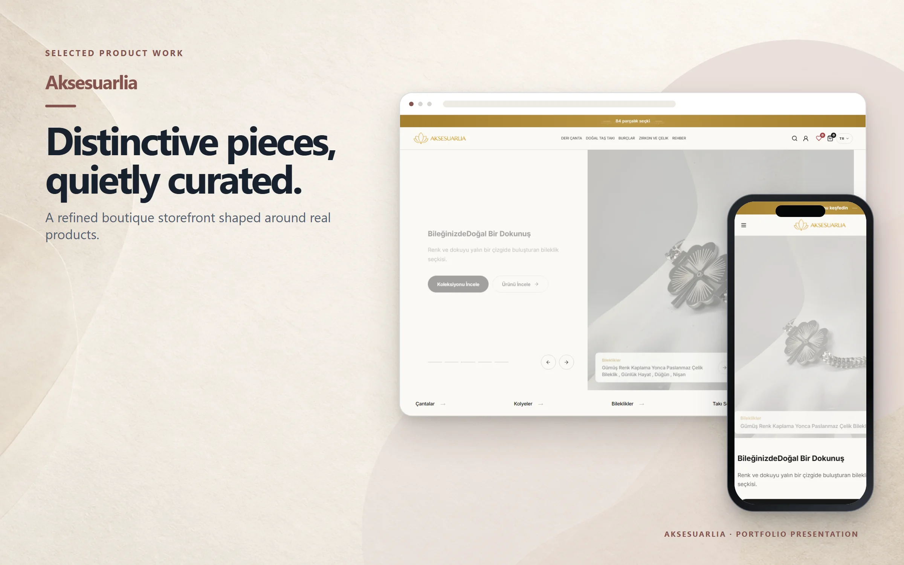
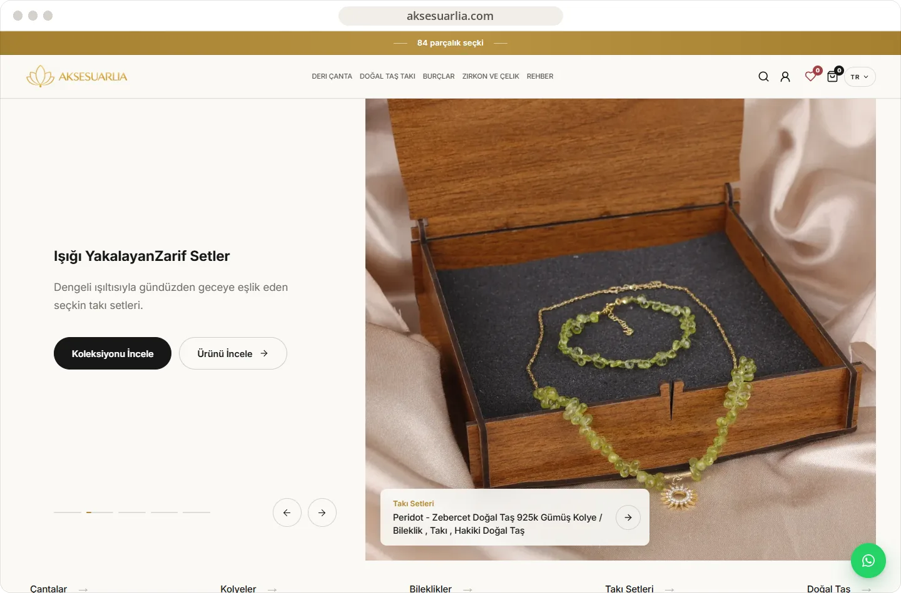
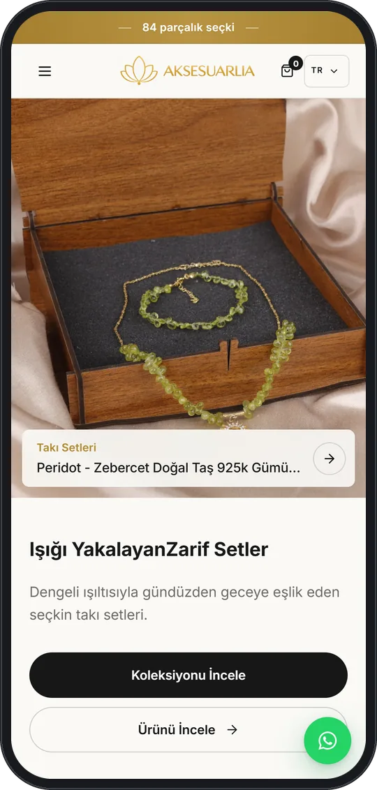

# Aksesuarlia

A curated commerce experience for leather bags, natural-stone jewellery, zodiac designs, and steel accessories.

**[Visit live website](https://aksesuarlia.com)**

## Highlights

- Collection-led discovery for bags, jewellery, and natural stones
- Search, account, wishlist, and cart entry points
- Editorial care and material guides
- Responsive Turkish storefront

## Verified technology

Shopify storefront and Liquid theme technology are confirmed from the live public site and the corresponding local Shopify project.

## Live interface

 

## About this repository

This presentation-only repository contains selected public screenshots, this README, and a small static introduction page. Application source and private configuration are not published here.

Visual content and brand assets remain the property of their respective owners. See [LICENSE](LICENSE).
